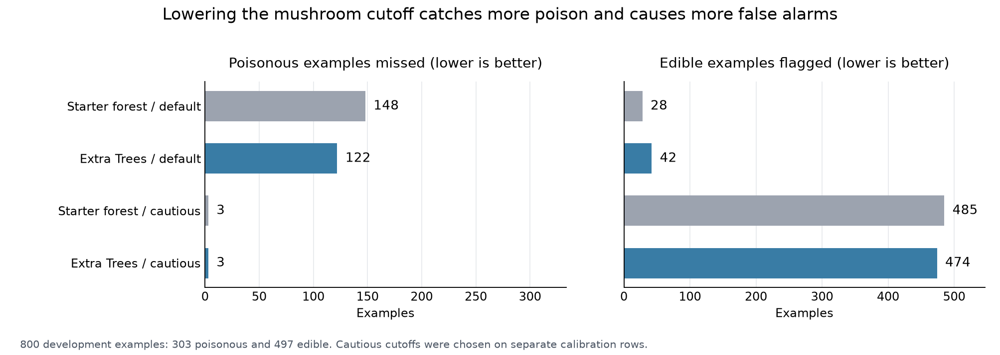
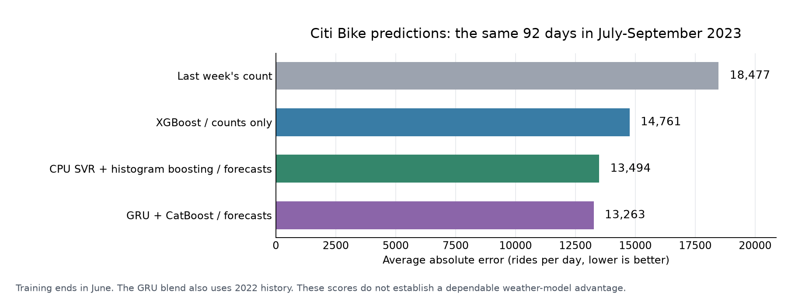

# CloudAI

The best DL group in the world ever.

Viviana Pajic, Tomislav Novosel, Muneeb Shakoor.

Deadline: 15 October 2026. Oral: 23 October.

## Run the app

Python 3.12.10. On Windows, run `scripts/setup_review.ps1` once, then:

```powershell
.\.venv-review\Scripts\python.exe app/review_server.py
```

Open http://127.0.0.1:8780.

## What we did and found

### Mushrooms: missing inputs and missed poison labels

We used the teacher's replacement dataset of 5,000 mushrooms. Many measurements were missing. Keeping only complete rows would leave just 8 of the 3,199 research training/calibration rows. We kept incomplete rows and learned how to fill gaps using training data only.

We started with a majority guess, logistic regression and random forest. Then we compared more tree and neural models, tuned their settings and tested preprocessing choices. Controlled comparisons supported removing the two noise columns and adding log and ratio features. Extra Trees became our selected research candidate.

Its default alarm cutoff missed 122 of 303 poisonous examples. A lower cutoff, chosen on separate calibration rows, caught 300/303 but also flagged 474/497 edible examples. The starter forest caught the same 300 with its cautious rule. Most of the improvement came from lowering the cutoff, which also caused many false alarms.



**AWS plan:** train and tune Extra Trees, then choose a cutoff for that new fit. We did not find a useful zero-miss classifier. An unflagged mushroom is not proven safe to eat.

### Citi Bike: weekly patterns and difficult days

We downloaded the trip files and counted rides by their actual start date. The audit found 35,107,120 rides across all 365 dates of 2023, with no duplicate ride IDs. Valid rides with empty unused station fields were kept.

Weekdays were busier in 31 of 38 complete weeks. That gave us a reason to try the calendar and the previous 28 daily totals when predicting the next day. We compared simple guesses, AutoML, Ridge, random forest and XGBoost, then tried more settings, archived weather forecasts and extra 2022 history.

We trained through June and checked July-September. Inputs use earlier ride counts and forecasts, not the day's actual weather or ride total. MAE below means the average size of a mistake in rides per day; lower is better. A blend averages two models' predictions.



**AWS plan:** start with the CPU SVR/histogram-boosting blend. Its MAE is 13,494, close to the GRU/CatBoost blend's 13,263, and it handles large errors better by RMSE. The GRU blend also uses 2022 training history and needs a GPU for our training code, so it is the optional route. Counts-only XGBoost remains our reference at 14,761.

Weather helped the recorded scores, but uncertainty checks do not establish a dependable improvement over XGBoost. Sudden quiet days still caused large mistakes, and we kept those days in the results.

These are **development results**. The 1,000 reserved mushroom rows and October-December bike targets remain unscored.

## Read in order

Follow [the notebook map](docs/NOTEBOOKS.md). Each notebook covers one step.

[Data sources](docs/DATA.md) · [Tasks](docs/TASKS.md) · [Run and release](docs/RELEASE.md) · [Work and AI use](docs/AI_USE.md)

All six handoff commits are on `main`. Next: actual AWS runs, release-model selection, one final-test evaluation, public hosting and a verified automatic update.
