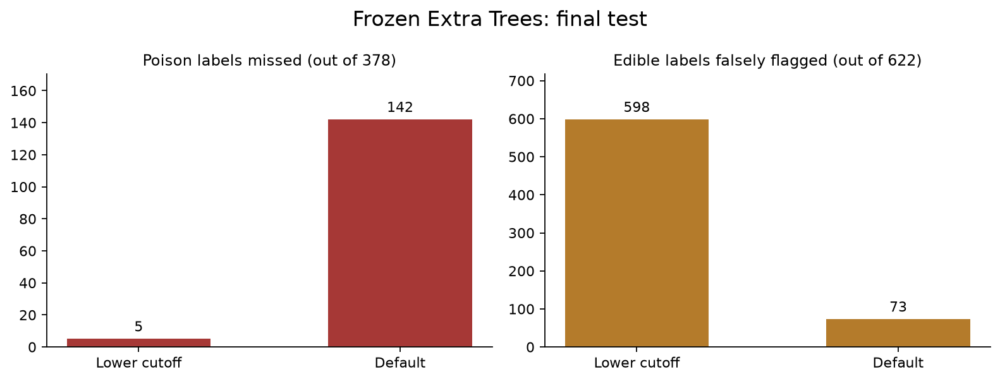
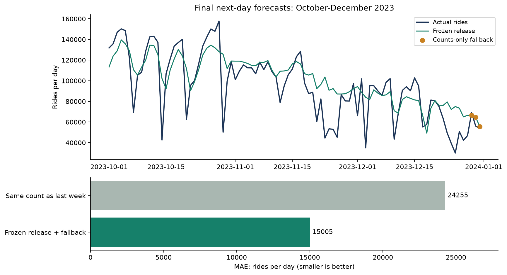

# CloudAI

The best DL group in the world ever.

Viviana Pajic, Tomislav Novosel, Muneeb Shakoor.

Deadline: 15 October 2026. Oral: 23 October.

## Run the app

Try the [public app](https://cloudai-team.onrender.com). The free host may take about a minute to wake up.

Python 3.12.10. On Windows, run `scripts/setup_review.ps1` once, then:

```powershell
.\.venv-review\Scripts\python.exe app/review_server.py
```

Open http://127.0.0.1:8780.

## What we did and found

### Mushrooms: missing inputs and missed poison labels

We used the teacher's replacement dataset of 5,000 mushrooms. Many measurements were missing. Keeping only complete rows would leave just 8 of the 3,199 research training/calibration rows. We kept incomplete rows and learned how to fill gaps using training data only.

We started with a majority guess, logistic regression and random forest. Then we compared more tree and neural models, tuned their settings and tested preprocessing choices. Controlled comparisons supported removing the two noise columns and adding log and ratio features. Extra Trees became our selected research candidate.

Its default alarm cutoff missed 122 of 303 poisonous examples. A lower cutoff, chosen on separate calibration rows, caught 300/303 but also flagged 474/497 edible examples. The starter forest caught the same 300 with its cautious rule. Most of the improvement came from lowering the cutoff, which also caused many false alarms.


**Cloud run:** Extra Trees was tuned and recalibrated on AWS. The final release keeps the original independently checked local fit. We did not find a useful zero-miss classifier. An unflagged mushroom is not proven safe to eat.

### Citi Bike: weekly patterns and difficult days

We downloaded the trip files and counted rides by their actual start date. The audit found 35,107,120 rides across all 365 dates of 2023, with no duplicate ride IDs. Valid rides with empty unused station fields were kept.

Weekdays were busier in 31 of 38 complete weeks. That gave us a reason to try the calendar and the previous 28 daily totals when predicting the next day. We compared simple guesses, AutoML, Ridge, random forest and XGBoost, then tried more settings, archived weather forecasts and extra 2022 history.

We trained through June and checked July-September. Inputs use earlier ride counts and forecasts, not the day's actual weather or ride total. MAE below means the average size of a mistake in rides per day; lower is better. A blend averages two models' predictions.


**Cloud run:** the CPU SVR/histogram-boosting blend. Its local MAE was 13,494, close to the GRU/CatBoost blend's 13,263, and it handled large errors better by RMSE. The GRU blend also uses 2022 training history and needs a GPU for our training code, so it is the optional route. Counts-only XGBoost remains our reference at 14,761.

Weather helped the recorded scores, but uncertainty checks do not establish a dependable improvement over XGBoost. Sudden quiet days still caused large mistakes, and we kept those days in the results.

These are **development results**, used to choose the release. AWS training is separate evidence, not a replacement score for these fits.

## Frozen release and final test

We chose the original Extra Trees fit and its calibrated cutoff, 0.0398. We chose the 75% GRU / 25% CatBoost bike blend because it had the lowest recorded development MAE. This is our selected candidate, not proof that it is the best possible model.

Before reading the reserved results, we locked the model files and settings in [release_decision.json](release_decision.json). Forecast preflight found missing GFS temperature hours on 29-31 December. We preserved the [first decision](reports/release_preflight_decision.json) and froze counts-only XGBoost as the fallback before testing. We kept incomplete weather days missing; no weather was invented.

Then we tested once: 1,000 unseen mushroom rows and 92 bike dates in October-December 2023.

| Mushroom rule | Poison labels caught | Edible labels flagged by mistake |
|---|---|---|
| Lower cutoff, 0.0398 | 373 / 378 | 598 / 622 |
| Default cutoff, 0.5 | 236 / 378 | 73 / 622 |



The lower rule missed 5 poisonous labels and flagged 96% of edible labels. Lowering the cutoff increases recall, but produces too many false alarms. We did not achieve a useful zero-miss classifier. Neither option can decide whether a real mushroom is safe to eat.

| Bike forecast | MAE, rides/day | RMSE, rides/day |
|---|---:|---:|
| Frozen GRU blend + counts fallback | 15,005 | 21,143 |
| Same count as last week | 24,255 | 33,689 |



The release reduced average error by 38% against last week's count on these dates. It still overpredicted by 5,829 rides/day on average. Each one-day forecast uses earlier completed counts; earlier test days become known history for the next day. It is not a forecast of the whole quarter made in September.

The GRU blend ran on 89 dates (MAE 15,367); XGBoost handled the 3 dates with missing weather. The archived forecasts use a 48-hour lead. Exact historical publication times are unverified. The default mushroom rule and bike baseline were declared before testing. We did not change the models after seeing these scores.

[Saved final results](reports/final_test_results.json) include model hashes, input hashes and predictions. Notebooks 11 and 18 explain the results.

## Read in order

Follow [the notebook map](docs/NOTEBOOKS.md). Each notebook covers one step.

[Data sources](docs/DATA.md) · [Tasks](docs/TASKS.md) · [Run and release](docs/RELEASE.md) · [Work and AI use](docs/AI_USE.md)

Both CPU AWS notebooks ran on 13 October. Extra Trees kept 600 trees and recalibrated its cutoff. The bike blend selected 200 boosting iterations; training-fold MAE was 9,711 rides. These cloud scores use different rows from the local checks above. See the executed notebooks and [saved runs](reports/aws/).

Both prediction paths are hosted and passed public checks. A pushed commit also passed GitHub checks, deployed automatically and passed the public checks again. The release is frozen and the final test is complete. The public app matches the frozen files, saved scores and local example predictions: [verification](reports/hosting_final_verification.json). Fresh Linux and Docker checks passed. Next: teammate review, demo rehearsal and Canvas submission.
