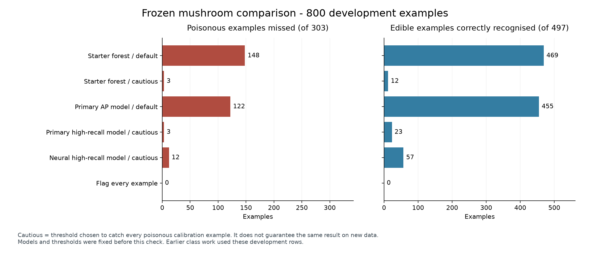

# Our project in simple words

We ask two questions: can measurements help us flag poisonous mushrooms, and can earlier rides help us predict tomorrow's bike total?

## Data decisions

| We saw this | So we did this | Why |
|---|---|---|
| Mushroom inputs are often empty | Keep the rows and fill gaps inside training folds | Dropping every incomplete row leaves almost no data |
| Some numeric values are large or zero | Keep them | We do not know that they are errors |
| Noise removal helped the controlled comparison | Exclude the two noise columns | The decision comes from results, not column names |
| Category codes have no numeric order | Use separate yes/no columns and a missing token | Do not pretend one letter is larger than another |
| Logs and guarded ratios helped the selected tree model | Add them to its pipeline | Ratios must handle zero denominators |
| Trip files cross year boundaries | Count by ride start date | January 2024 contains 410 December 2023 starts |
| Empty station fields do not prevent counting valid starts | Keep those rides | Our target is the citywide daily total |
| Weekdays are busier in 31 of 38 complete weeks | Try weekday features | The average within-week gap is about 13,467 rides/day |
| Quiet days can be real | Keep difficult dates | Removing them would make the score look better unfairly |

The 2023 audit counted 35,107,120 rides across 365 dates. It found no duplicate ride IDs or missing dates. Raw trip ZIPs stay out of GitHub.

## Mushrooms

Extra Trees is a group of decision trees. Each tree asks small questions about the inputs. Their average gives a score. A threshold decides when to flag poison.

Lowering the threshold catches more poisonous labels. It also flags more edible labels. These are the same frozen 800 checking rows, containing 303 poison labels and 497 edible labels:

| Model and rule | Poison caught | Poison missed | Edible flagged |
|---|---:|---:|---:|
| Fresh starter forest, 0.5 | 155 | 148 | 28 |
| Extra Trees, 0.5 | 181 | 122 | 42 |
| Fresh starter forest, cautious | 300 | 3 | 485 |
| Extra Trees, cautious | 300 | 3 | 474 |
| Flag everything | 303 | 0 | 497 |

Most recall improvement comes from the lower threshold. Extra Trees lets eleven more edible labels through than the cautious starter. It still misses three poison labels. The cautious rule has 99.01% poison recall but only 40.38% overall accuracy. We did not find a useful zero-miss classifier. Unflagged does not mean safe to eat.

The replacement file may contain changed labels. Disagreement with a prediction does not prove a label is wrong, so we changed none. Iterative numeric filling kept its convergence warning. Native missing-value handling was almost tied in the controlled check; filling is not a proven large gain.

## Citi Bike

Predict one day's citywide rides from the preceding 28 completed daily totals and the date. To predict tomorrow, today's whole day must have finished. Do not use the target day's actual total as input.

| Model | Required inputs | Development MAE | RMSE |
|---|---|---:|---:|
| Last week's count | Counts | 18,477 | 28,230 |
| Fresh CPU XGBoost | Counts | 14,761 | 23,432 |
| CPU SVR/Hist blend | Counts + forecasts | 13,494 | 19,180 |
| GRU/CatBoost blend | Counts + forecasts | 13,263 | 19,636 |

MAE is the average size of a mistake in rides/day. RMSE gives large mistakes more weight. Lower is better.

XGBoost and histogram boosting add small trees that correct earlier mistakes. SVR learns a smooth relationship from scaled inputs. GRU reads counts in time order. The blends average two predictions with fixed 75%/25% weights.

The GRU blend has the lowest recorded MAE. The CPU weather blend has a better RMSE and is easier to train on a student CPU account. Counts-only research blends did not beat XGBoost. The uncertainty intervals still include no improvement over XGBoost, so we cannot claim a dependable win.

Weather means archived forecasts, not observed target-day weather. GRU needs six forecast values for the target date. The CPU blend also uses forecast changes, so it needs those values for the seven preceding dates. Exact old publication times were not verified. The app has no live count or weather feed.

September was hard. On 23 September, 36,069 rides were recorded, but the weather models still predicted about 104,000-108,000. We keep this failure in the comparison.

## How we checked fairly

| Experiment | Training and selection | Later check | Reserved final test |
|---|---|---|---|
| Class mushroom workflow | 4,000 development rows, repeated folds | Development predictions | 1,000 rows |
| Mushroom research | 2,559 search rows; 640 calibration rows | 800 frozen confirmation rows | Same 1,000 rows |
| Bike class/CPU weather | 153 targets through June | July-September, 92 days | Oct-Dec |
| Expanded GRU weather | 518 earlier targets, including 2022 | Same 92 days | Same Oct-Dec |

One mushroom row was quarantined to avoid an identical-input collision. Finalists were chosen before the later checks. The original class work had already used development data, so these later checks are development evidence. Different splits cannot be compared as one leaderboard. The final tests are untouched.

Preparation learns inside training folds. Mushroom duplicate groups stay together in the research folds. Bike checking dates come after their training dates. A new mushroom fit needs a new calibration threshold.

## What remains

All six handoff commits are on main. The local app checks and GitHub CPU rebuild, app checks and Docker build passed. Next: run AWS training, choose and freeze release models, evaluate the untouched final tests once, finish public hosting and automatic deployment, check the release and submit. AWS alone does not finish the project.

Weather attribution: Open-Meteo, NOAA GFS and JMA GSM, [CC BY 4.0](https://creativecommons.org/licenses/by/4.0/). We aggregated in New York time, corrected rain intervals and floored tiny negative rain forecasts. Raw records and flags are retained.
